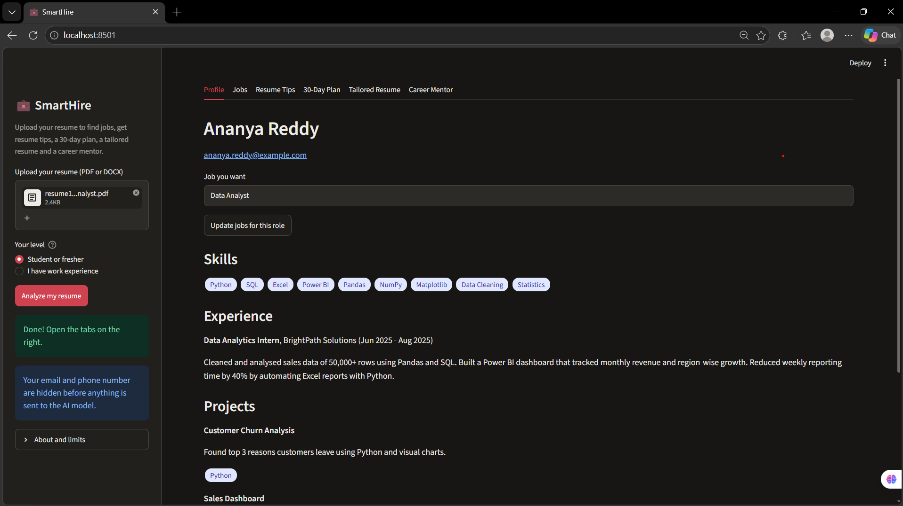
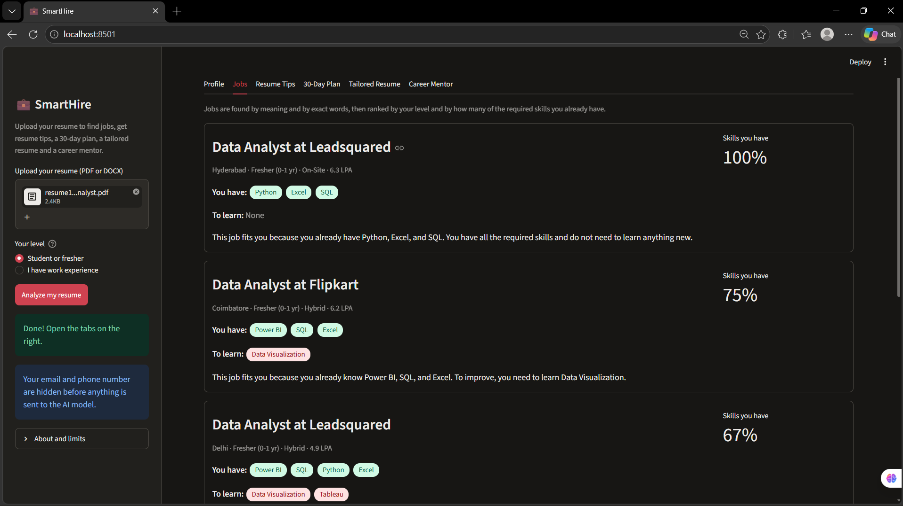
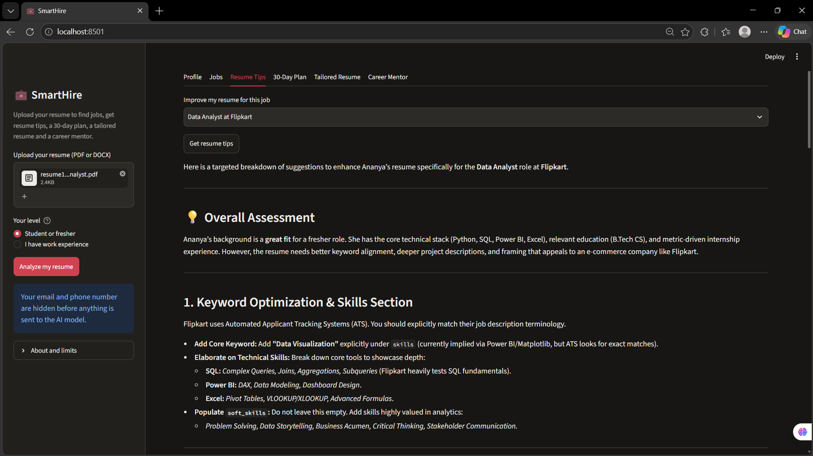
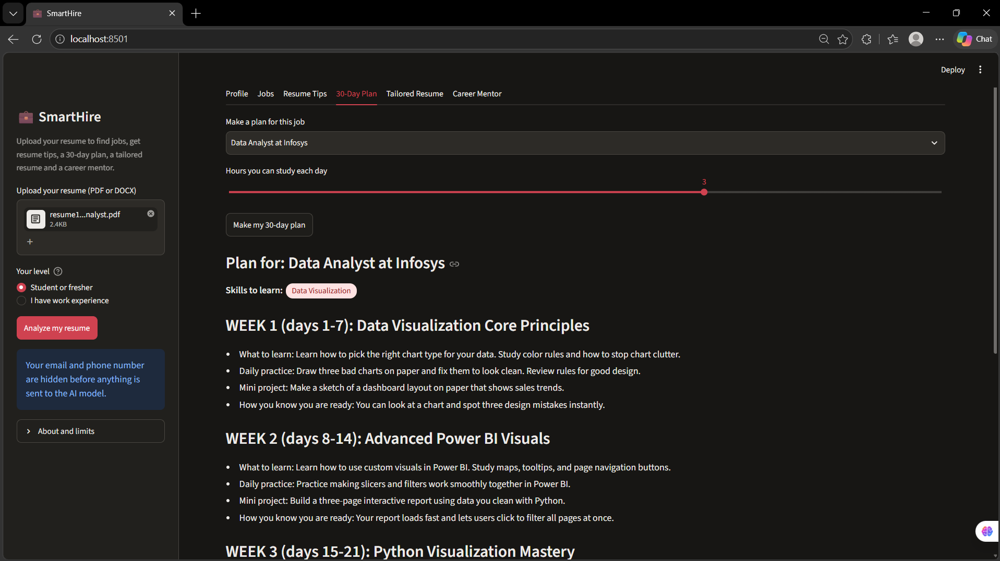
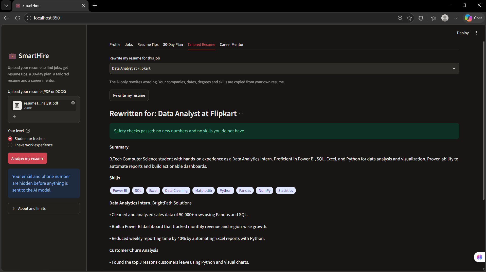
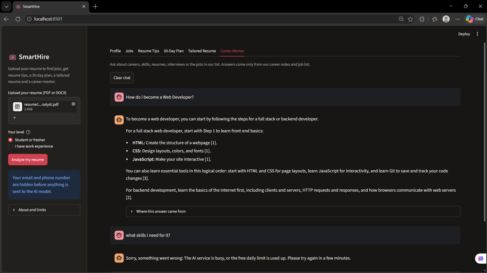
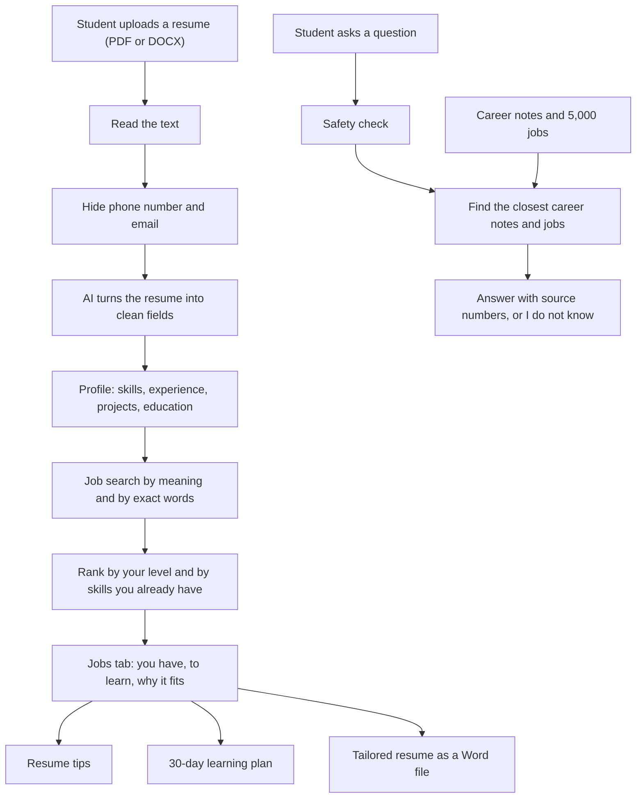

# SmartHire GenAI: Resume Matching and Career Mentor

**Live app:** https://smarthire-genai-bg56ygv2jerqyvslfzzbku.streamlit.app/

SmartHire is a career helper for students. Upload your resume and it reads your details, finds jobs that fit you, shows which skills you already have and which you still need, suggests how to improve your resume, makes a 30-day learning plan, rewrites your resume for a job you choose, and answers career questions in a chat. Chat answers come only from our own career notes and job list, and the mentor says so when it does not know.

Click **Try a sample resume** in the app if you do not want to upload your own.

> The app uses a free AI service with a daily limit. If it shows a "busy" message, try again later.

## What it does

| Tab | What you get |
|---|---|
| Profile | Your name, skills, experience, projects and education, read from your resume |
| Jobs | The 5 best-fitting jobs, with skills you have, skills to learn, and a short reason |
| Resume Tips | Missing skills, weak lines with better wording, and a rewritten summary |
| 30-Day Plan | A four-week plan that teaches only the skills a job asks for and you lack |
| Tailored Resume | Your resume reworded for a chosen job, as a Word file |
| Career Mentor | A chat that answers from our notes and job list, shows its sources, and remembers the last questions |

## Screenshots








## How it works



- **Finding jobs:** every job is turned into numbers once, so jobs with a similar meaning can be found even when the words differ. A second search looks for exact tool names such as DAX or Terraform. Both lists are joined.
- **Ranking:** jobs for students are ranked by how close they are, by job level (Fresher and Junior first), and by how many of the required skills you already have.
- **Mentor:** it picks the closest career notes and jobs for a question. If nothing is close enough, it refuses without asking the AI at all. Otherwise the AI may only use what was found, and every fact carries a source number.
- **Honest resume rewrite:** the AI never sees your name or email. Code copies your companies, dates and degrees from your own resume, keeps only your own skills, and rejects any rewrite that adds a new number or a skill you do not have.

## Safety and privacy
- Messages that try to change the mentor's rules, harmful requests, empty and very long messages are stopped before any AI call.
- Phone numbers and emails are replaced with placeholders before text goes to the AI.
- A resume that contains hidden instructions for the AI is rejected.
- Saved AI answers stay on the computer that runs the app. They are never uploaded to GitHub.

## Results
All numbers come from the test files in `reports/`. Each test was written before looking at results.

| Test | Result |
|---|---|
| Job search, 20 test profiles (top 5 jobs each) | Relevant job titles: 100 of 100. Suitable level for a student: 100 of 100, up from 52 of 100 before a level score was added. |
| Exact tool names, 23 searches | Jobs listing all searched tools: 79% with meaning search only, 90% with keyword search only, 88% combined. |
| Two search models compared | MiniLM kept. BGE small was better without a stated role (97% against 86% relevant) but lower on exact tool names (76% against 79%). |
| Mentor, 30 questions | Career questions passed all automatic checks: 17 of 20 at first, 20 of 20 after the fix. Unrelated questions refused: 5 of 5. Questions our documents cannot answer, refused: 5 of 5. No invented numbers found. |
| Safety checks | 11 of 11 test messages handled correctly. |
| Resume tips instruction | The weak version invented skills and projects. The better version did not. |
| 30-day plan checks | Better instruction passed 4 of 5 plans. Weak instruction passed 0 of 2. |
| Tailored resume checks | 4 of 4 rewrites passed, and all 4 Word files opened. |

## Limits
- Jobs come from a fixed list of 5,000 postings, not live websites.
- The job list has titles and skills but no job descriptions.
- "Relevant" is judged by job-title words I wrote. The test profiles are made up and tidy, and all assume a fresher.
- The automatic mentor checks cannot judge whether an answer is correct, so answers were also read by hand.
- AI can make mistakes. Check every tip, plan and rewrite against your real experience.

## Run it on your computer
1. Clone and open the folder.
   ```
   git clone https://github.com/Pramodhvarma2007/Smarthire-genai.git
   cd Smarthire-genai
   ```
2. Create a virtual environment and install the packages.
   ```
   python -m venv venv
   venv\Scripts\activate
   pip install -r requirements.txt
   ```
   On Mac or Linux, use `source venv/bin/activate`.
3. Copy `.env.example` to `.env` and put your Google AI key in it.
4. Start the app.
   ```
   streamlit run app/streamlit_app.py
   ```

The saved search files are already in `vectorstore/`. To rebuild them, download the job list (`data/jobs/jobs.csv`) from the dataset page below, then run `python build_index.py`, `python make_notes.py` and `python build_notes.py`.

To repeat the tests: `python run_eval.py`, `python run_tool_eval.py`, `python run_compare.py`, `python run_mentor_eval.py` and `python test_guardrails.py`.

## Project folders
```
app/             the Streamlit app
src/parsing/     read the resume file and its details
src/search/      job search, exact-word search, matching and ranking
src/generate/    instructions, resume tips, learning plan, resume rewrite
src/mentor/      the career mentor
src/safety/      safety checks
notebooks/       three notebooks that explain the ideas step by step
reports/         test results and notes for every stage
vectorstore/     saved search files
docs/            screenshots
```

## Data
Job postings: <dataset name : Naukri Job Postings  and Kaggle link : https://www.kaggle.com/datasets/sridipbasu/india-tech-jobs-2024-2026-salary-and-skills>. Career notes were written with AI help and checked by me.

Built as a capstone project for a Generative AI internship.